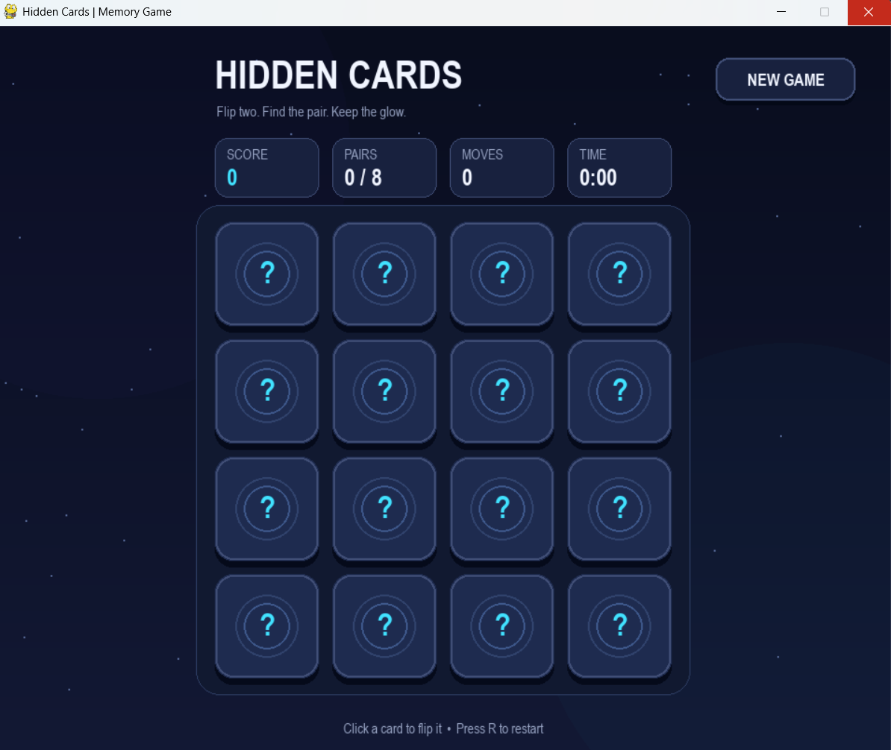
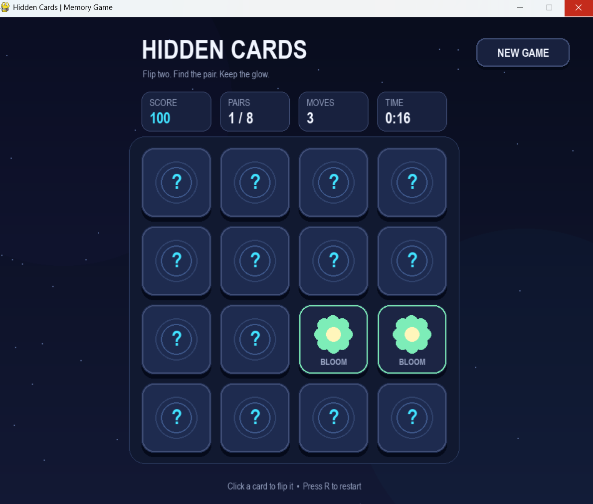
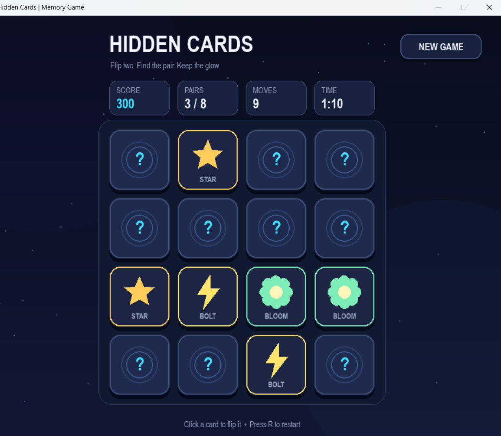

# Memory Cards Game

A simple card-matching memory game built with Python and Pygame. Flip two cards at a time, find matching pairs, and clear the board in as few moves and as little time as possible.

## Features

- 4x4 card grid with 8 pairs of glowing icons
- Card flip and hover animations
- Move counter, score tracker, and timer
- Win popup showing your final time and total moves
- Quick restart button (or press `R` on the keyboard)

## How to Run

1. Make sure you have Python installed, then install Pygame:
```bash
pip install pygame
```
## Screenshots

<p align="center">
  
  <br>
  <em>Initial board layout</em>
</p>

<p align="center">
  
  <br>
  <em>Flipping and matching cards</em>
</p>

<p align="center">
  
  <br>
  <em>Win screen with final stats</em>
</p>
