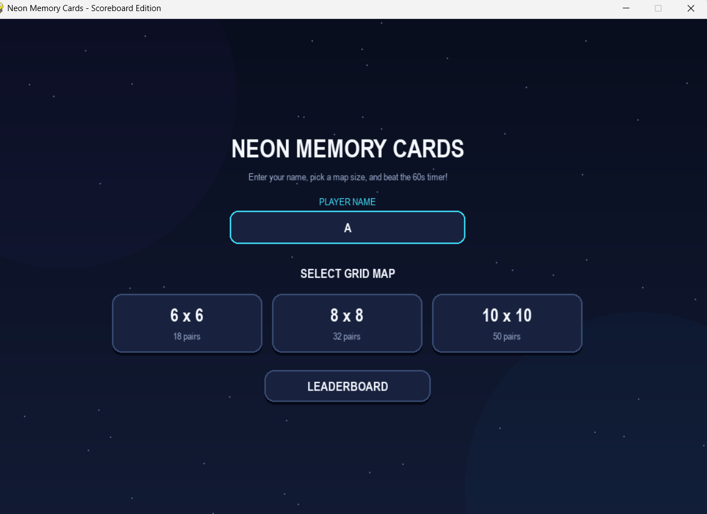
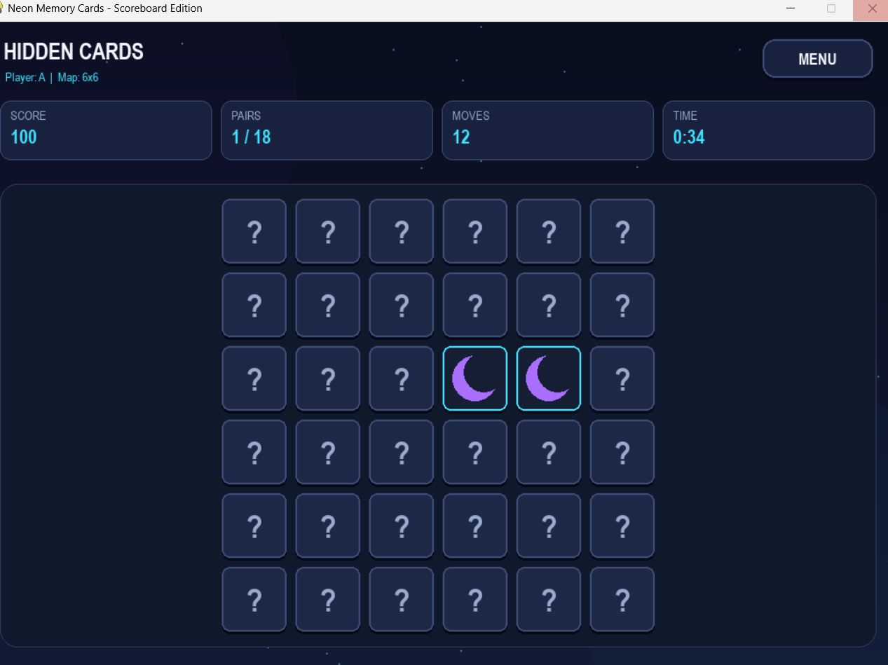
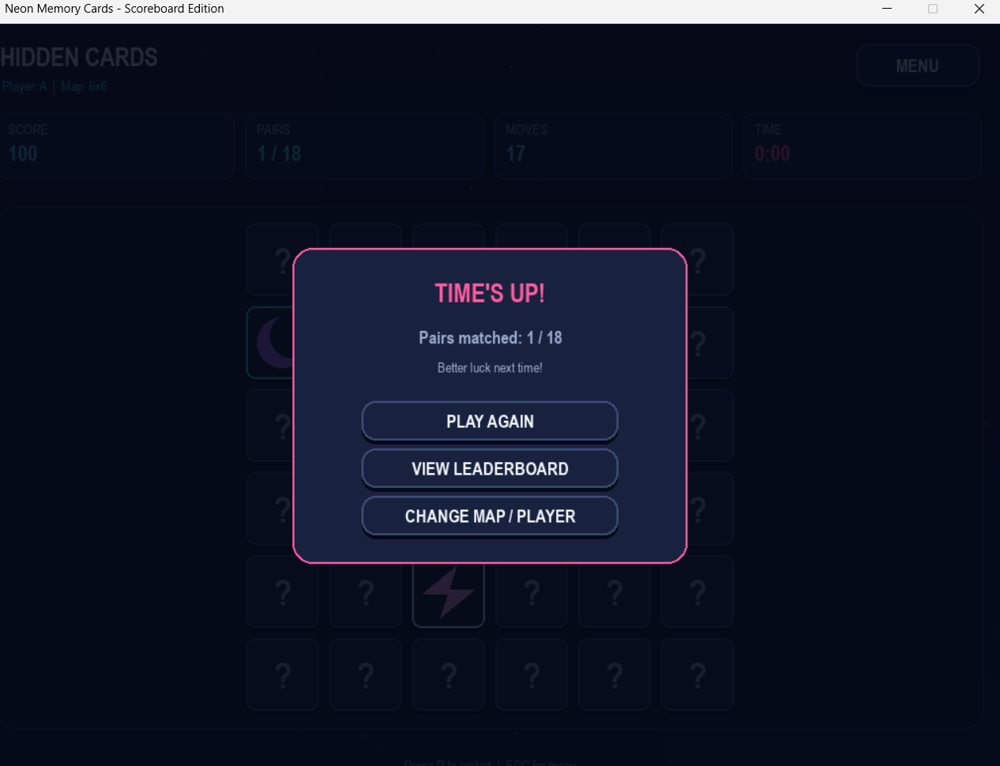

# Memory Cards Game

A simple card-matching memory game built with Python and Pygame. Flip two cards at a time, find matching pairs, and clear the board in as few moves and as little time as possible.

## Features

- 4x4 card grid with 8 pairs of glowing icons
- Card flip and hover animations
- Move counter, score tracker, and timer
- Win popup showing your final time and total moves
- Quick restart button (or press `R` on the keyboard)

## How to Run

1. Make sure you have Python installed, then install Pygame:
```bash
pip install pygame
```
## Screenshots

## 📸 Gameplay & Interface

<p align="center">
  
</p>
<p align="center">
  <em>Figure 1: Main Menu with Player Name Input & Grid Selection</em>
</p>

<br/>

<p align="center">
  
</p>
<p align="center">
  <em>Figure 2: Active Gameplay with Timer, Flip Animations & Cards</em>
</p>

<br/>

<p align="center">
  
</p>
<p align="center">
  <em>Figure 3: Hall of Fame & Leaderboard Records</em>
</p>
