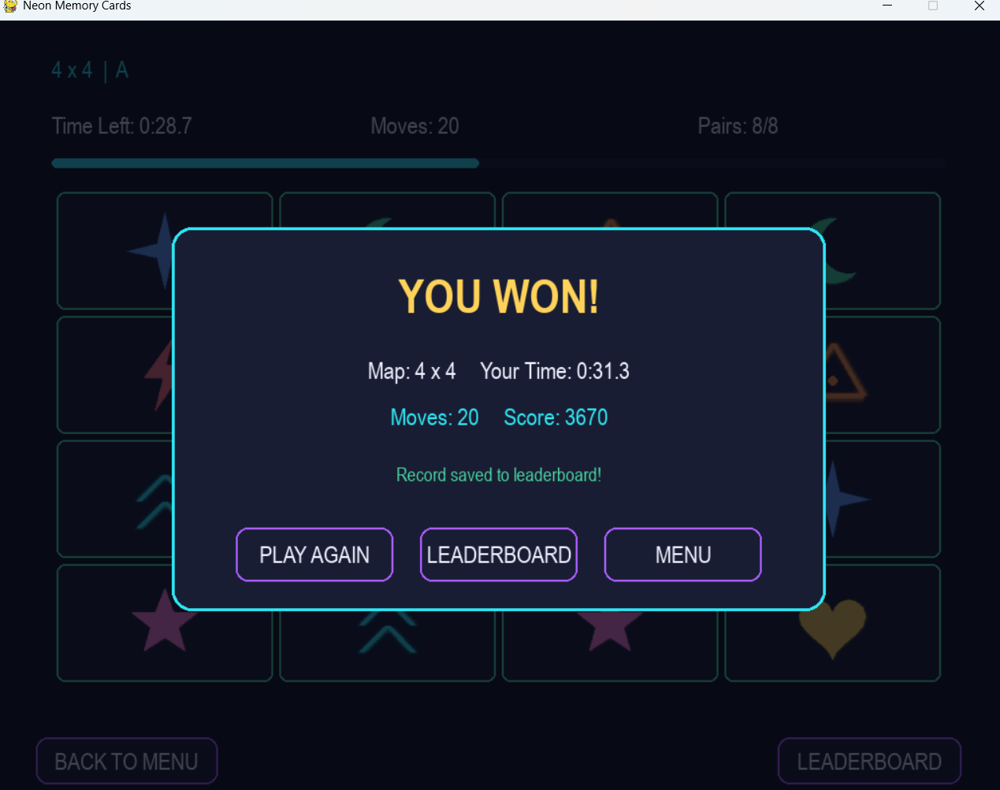
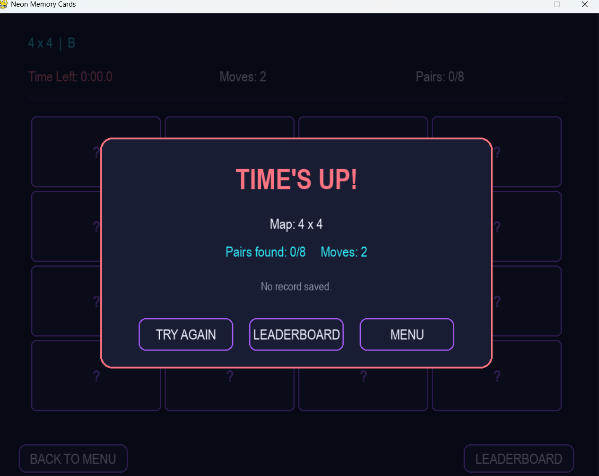

# Neon Memory Cards

Neon Memory Cards is a memory matching puzzle created with Python and Pygame. It shows a bright neon look lets you use your pictures offers several grid sizes and has a leaderboard that is split by size.

---

## Features

- **Neon Visuals:** A clean cyberpunk style color set and custom card design.

- **Custom Card Images:** Your pictures are resized for each pair of cards.

- **Multiple Grid Sizes:**

4 X 4 (16 cards)

6 X 6 (36 cards)

8 X 8 (64 cards)

10 X 10 (100 cards)

- **Size-Tabbed Leaderboard:** Each grid size has its high‑score list.

- **Score Calculation:** Players are ranked by the time they take. The number of moves they make.

- **Persistent Storage:** High scores are saved in a JSON file.

---

## Installation & Running

### Prerequisites

Make sure Python 3.8 or newer is installed on your machine.

### Steps

1. Clone the repository. Download the source code:

```bash
git clone https://github.com/your-username/neon-memory-cards.git

cd neon-memory-cards
```
## Screenshots

##  Gameplay & Interface

<p align="center">
  
</p>
<p align="center">
  <em>Figure 1: Main Menu with Player Name Input & Multi-Grid Selection</em>
</p>

<br/>

<p align="center">
  
</p>
<p align="center">
  <em>Figure 2: Active Gameplay with Timer, Match Scores & Card Animations</em>
</p>

<br/>

<p align="center">
  
</p>
<p align="center">
  
</p>
<p align="center">
 <em>Figure 3: Victory & Game Over Modal Dialogs</em>
</p>


<br/>

<p align="center">
  
</p>
<p align="center">
  <em>Figure 4: Hall of Fame / Leaderboard Records</em>
</p>

